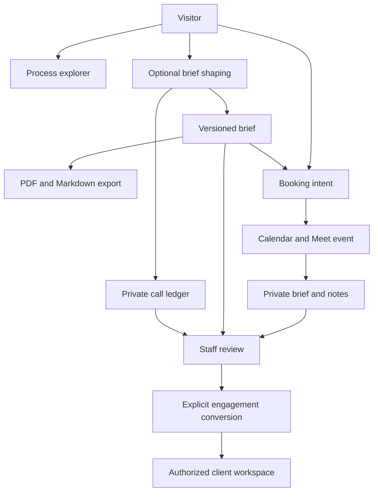

# Velcrafting consulting and client experiences

**Version:** 0.3  
**Date:** 2026-11-10  
**Status:** REVIEW DRAFT, IMPLEMENTATION HANDOFF  
**Repository baseline:** website2025 at `7a2da367d924c67133dce7a32daaafcbaf271480`

## The intended result

Create two connected experiences. `/consulting` explains how Velcrafting works and lets a visitor develop an initial project brief through an optional conversation. `client.velcrafting.com` becomes the private, continuing record for agreed work, from discovery through delivery.

The connection is deliberate: a visitor can ask one question, shape a partial brief, export it, or schedule a conversation without finishing a questionnaire. A confirmed meeting carries the selected brief revision and prepared notes. Staff then reviews the useful context before creating a client engagement. Public exploration, meeting access and client authorization remain separate.

Someone who explicitly books without a brief receives the meeting and notes, with that absence shown accurately. A selected brief must be attached as a literal PDF; a link alone is insufficient.

This packet specifies the full requested target and a phased build. It contains no application implementation, applied database migrations, new account configuration or claim of live integration completion. Earlier review notes that recommended retaining only completed briefs are superseded by this packet.

## Decisions already made

| Decision | Implementation direction |
| --- | --- |
| Public destination | `/consulting`, connected to the existing Velcrafting identity and service positioning. |
| Private destination | `client.velcrafting.com`, with explicit host routing and named stakeholder authorization. Domain readiness is unverified. |
| Client authentication | Supabase email one-time codes. No shared client passcode. |
| AI provider | Command Code Provider API with DeepSeek v4.1 Flash. Verify the account's exact model ID and entitlement before activation. |
| AI records | Record every dispatched provider attempt and its submitted input, response and available usage evidence, including unfinished exploration. No unsent keystroke capture. |
| Commercial agreement | Record evidence of external agreement to an exact issued version. No custom electronic-signature product in the first release. |
| Templates | Reusable private working templates for several engagement types, with shared discovery, proposal, progress, decision and delivery records. |
| Scope controls | Let visitors explore meaningful work choices. Do not invent prices, delivery dates or a quote from a slider. |
| Brief export | Deterministic PDF, Markdown and copy, available for partial briefs without email capture or another model call. |
| Meeting conversion | Book during exploration. Target one Google Meet calendar event with owner and visitor invited, the dated brief PDF attached, and a prepared shared notes document. |
| Early email | Optional save/resume capture with email verification. Follow-up uses a separate affirmative choice. |

The chosen provider does not establish that the current subscription can power production traffic. The inspected documentation supports a compatible API route, while the actual account, allowance and data settings still need verification. Do not substitute GPT, MiniMax, another model or Gateway billing automatically.

## Read this packet

| Document | What it resolves |
| --- | --- |
| [Repository baseline](00-repository-baseline.md) | Actual stack, reusable components, relevant paths and unverified infrastructure. |
| [Public consulting](01-public-consulting.md) | Content, process explorer, optional conversational shaping, controls and accessibility. |
| [Private workspace](02-private-workspace.md) | Client and staff journeys, navigation, stages and minimum administration. |
| [Data, permissions and versions](03-data-permissions-and-versions.md) | Tenant boundaries, authorization, document versions and agreement evidence. |
| [AI observability and data](04-ai-observability-and-data.md) | Every-call ledger, cost uncertainty, raw content, staff review and retention. |
| [Booking, export and follow-up](05-booking-export-and-follow-up.md) | Partial-brief export, Cal.com, Google Calendar/Meet, attachments, notes and consented reminders. |
| [Delivery roadmap](06-delivery-roadmap.md) | Sequenced implementation and what is required versus deferred. |
| [End-to-end acceptance](07-end-to-end-acceptance.md) | Concrete journeys, abuse cases, mobile checks and evidence requirements. |
| [Copy and content](08-copy-and-content.md) | Initial page, notice, consent, status and failure copy. |
| [Integration readiness](09-integration-readiness.md) | Provider, identity, calendar, email and domain setup gates. |
| [Agent start](AGENT-START.md) | Implementation instructions, first slice, boundaries and reporting contract. |
| [Sources](SOURCES.md) | Pinned repository evidence, primary product references and limitations. |

Read the overview, baseline, roadmap and agent start first. Feature owners should then read their specification and its data/security dependencies.

## The experience and its records

The arrows describe record relationships, not automatic permission grants. Staff review of an inquiry can happen after the first question. A person need not finish, identify themselves or book for the call to be recorded.

## Minimum practical scope

The first production target includes the public process explorer, bounded AI shaping, call records and a small staff review surface; optional verified save/resume; partial-brief export; booking with verified meeting materials; and a private client workspace with named access, versioned publication, agreement evidence and handoff.

The target is larger than a single landing page. Build it in reviewable increments. The static public process and ordinary contact path can work before AI or scheduling integrations are activated. The full conversion target is not complete until the actual booking carries the correct accessible attachments.

Keep comments, client uploads, client-side proposal signing, payments, invoicing, chat, broad campaign automation, task management, CRM integrations and client AI Q&A outside the first release. The one optional unfinished-inquiry reminder belongs to the specified conversion flow; it does not justify a campaign system.

## Reusable workflow templates

The `templates/` directory contains common records. The `workflows/` directory supplies four starting modules:

1. [Review and decision](workflows/01-review-and-decision.md): clarify a problem, assess options and recommend a next decision.
2. [Prototype and software](workflows/02-prototype-and-software.md): investigate a concept, build bounded software and verify its handoff.
3. [Workflow and AI integration](workflows/03-workflow-and-ai-integration.md): connect systems and automate selected work with explicit human decisions and recovery.
4. [Communications and knowledge](workflows/04-communications-and-knowledge.md): improve information structure, reporting, documentation or communication.

Use only the stages that help an engagement. A review need not have a separate quote, a software build need not have weekly updates, and delivery can conclude with a decision rather than a deployed application.

These files are blank source templates suitable for this repository. Completed records, private master copies, internal estimates, real call logs and client data must live in private runtime storage. The [example](examples/fictional-engagement.md) is fictional. Template version 0.1 is retained inside the version 0.3 packet; those are separate version numbers.

## Remaining input and verification

No further product choice is needed to start the local implementation. The selected auth, provider, recorded-agreement and template directions are settled.

Before public activation, the owner still needs to adopt a concrete operating allowance and the proposed retention/reminder policy. Proposed defaults are raw exploratory content for 30 days after inactivity, unconverted inquiry/contact data for 90 days, and minimized usage metadata for 12 months. The proposed reminder is one message after 48 hours, only to a verified contact who opted in. Sending remains disabled until the owner reviews that copy and schedule.

The implementation also needs account evidence, not guesses: Command Code API/model entitlement, an authorized Google organizer/calendar and Cal connection, working Supabase Auth and private storage, email delivery and client-host DNS/TLS. Those are readiness checks and scoped setup actions. They do not reopen the product decisions above.

## Completion language

Use **specified**, **implemented**, **fixture-verified**, **integration-verified** and **production-enabled** accurately. A mocked provider, screenshot, generated note or successful booking callback cannot establish that a live model call was recorded correctly, a guest can open an attachment or a tenant cannot read another tenant's data.

The implementation agent must leave an evidence record for each release gate. See [end-to-end acceptance](07-end-to-end-acceptance.md).
